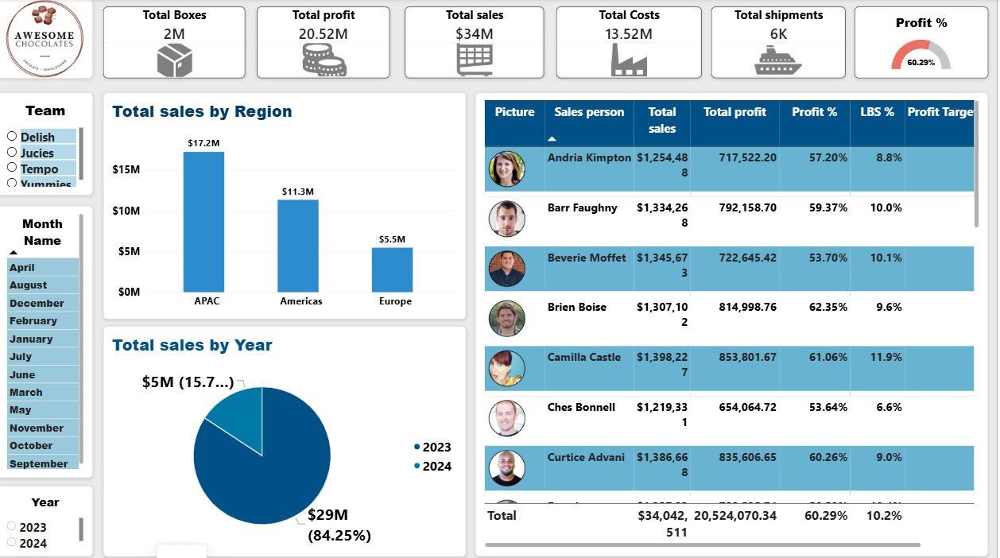
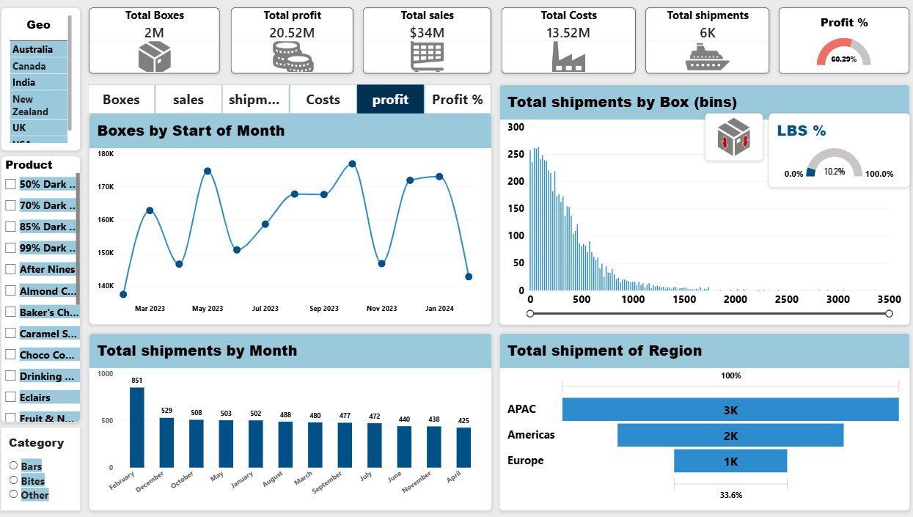

# Awesome Chocolates – Sales & Shipment Performance Dashboard (Power BI)

An interactive 2-page Power BI report that helps a chocolate company's sales managers track sales, profit and shipment efficiency by region, country, product, team and salesperson.

> **Personal portfolio project** built on the public *Awesome Chocolates* sample dataset (a fictional company, originally published by Chandoo.org).


---
## Business problem
Sales managers need one place to answer:
- Which regions, countries and products drive sales and profit?
- Which salespeople are below the profit target?
- How many shipments are inefficient (fewer than 50 boxes)?

## Dataset
| Item | Detail |
| --- | --- |
| Shipment records |	6,113 |
| Period	| Feb 2023 – Feb 2024 |
| Coverage	| 6 countries, 3 regions, 22 products, 3 categories, 25 salespeople, 4 teams |
| Source	| Excel workbook (5 tables) |

## Data model
Star schema: one fact table (`shipments`) related many-to-one to four dimension tables (`products`, `people`, `locations`, `calendar`), plus a dedicated measures table.

## Tools and techniques
- **Power BI Desktop:** report design, slicers, gauges, funnel chart, salesperson table with photos
- **Power Query:** added Year, Month, Month Name, Day of Week and Start of Month columns to the calendar table
- **DAX:** 11 measures and 2 calculated columns
- **Field parameter:** one selector switches the trend chart between 6 KPIs
  
### Key DAX
```DAX
Total Profit = [Total sales] - [Total Costs]
Profit %     = DIVIDE([Total profit], [Total sales])
LBS Count    = CALCULATE([Total shipments], shipments[Boxes] < 50)
LBS %        = DIVIDE([LBS Count], [Total shipments])
Total Sale Prev Month = CALCULATE([Total sales], PREVIOUSMONTH('calendar'[Date]))
Profit Target Indicator = IF([Profit %] > [Profit Target], 2, 1)   -- target = 60%

-- Calculated columns
costs        = RELATED(products[Cost per box]) * [Boxes]
Boxes (bins) = INT(shipments[Boxes] / 20) * 20
```
## Key insights
| Metric	Result
| Total sales / profit	| **$34.0M / $20.5M** |
| Profit margin |	**60.3%**, just above the 60% target |
| Low box shipments (LBS %) |	**10.2%** of shipments |
| Top region |	**APAC: $17.2M (51% of sales)** |
| Top country	| **New Zealand: $5.9M** |
| Lowest-margin country |	**UK: 57.2%** |
| Salespeople below 60% target | **11 of 25** |
| Product margin range	| **17.4%** (Baker's Choco Chips) to **87.1%** (Peanut Butter Cubes) |

## Recommendations
1. **Review pricing for low-margin products. **Baker's Choco Chips, Drinking Coco and 50% Dark Bites all have margins below 30%.
2. **Coach the 11 salespeople below target. **Their margins range from 53.6% up to just under 60%.
3. **Reduce low box shipments in India and the USA, **which have the highest LBS % (11.8% and 11.1%).

##Report pages
| Shipments page |	Sales page |
| ---| ---|
| 	|  |

##How to open
Download `Awesone chocolate dashboard.pbit` and open it in **Power BI Desktop**. When prompted, point it to the Awesome Chocolates sample Excel file.
---
**Ravina Gaikwad** · Data Analyst · LinkedIn https://linkedin.com/in/ravina-gaikwad-049399222
